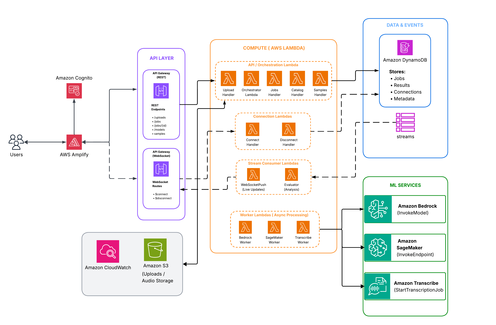

# TranscribeBench

A scalable, event-driven AWS platform for uploading audio files and comparing transcription outputs from multiple AI models in parallel. Pick two models from a catalog spanning Amazon Bedrock, SageMaker-hosted models (Distil-Whisper Large v3, Qwen3 ASR, and NVIDIA Parakeet TDT 0.6B v3), and AWS Transcribe — then view side-by-side results with latency and cost benchmarks streamed in real time.

## Features

- Upload audio (WAV, up to 500 MB) via pre-signed S3 URLs
- Compare any 2 models from a catalog of transcription services
- Real-time result streaming over WebSocket as each model finishes
- Side-by-side diff view highlighting textual differences
- Per-model benchmark metrics: latency (ms) and estimated cost (USD)
- Optional accuracy evaluation when a ground-truth `.txt` is provided: WER, MER, Semantic WER, and an LLM-as-Judge score with rationale (see [Evaluation methodology](docs/EVALUATION.md))
- Paginated job history with full result retrieval
- Email/password authentication via Amazon Cognito
- Responsive React frontend deployed on AWS Amplify

## Architecture



End-to-end flow: the React frontend authenticates against an Amazon Cognito User Pool, uploads audio to S3 via pre-signed URLs, and triggers an orchestrator Lambda. The orchestrator fans out to per-model worker Lambdas (Bedrock, SageMaker, Transcribe), which write results to DynamoDB. A WebSocket API streams `RESULT`, `JOB_COMPLETE`, and `HEARTBEAT` messages back to the client as each model finishes.

When a ground-truth transcript is uploaded alongside the audio, a separate Evaluator Lambda — triggered by the same DynamoDB stream — computes WER (locally) and three Bedrock-driven accuracy metrics (MER, Semantic WER, LLM-as-Judge), and writes them back to the same table so the WebSocket pushes an `EVALUATION` event to the client. See [`docs/EVALUATION.md`](docs/EVALUATION.md) for the methodology and how it relates to the AssemblyAI guide it is based on.

## Project Structure

```
├── infra/                  # AWS CDK (TypeScript)
│   ├── bin/                # CDK app entry point + context loader
│   └── lib/
│       ├── api/            # REST API + WebSocket API constructs
│       ├── ai/             # Bedrock, SageMaker, Transcribe workers + BYOC endpoints
│       ├── auth/           # Cognito user/identity pools, seeded test user
│       ├── compute/        # Orchestrator, upload, jobs, websocket-push, evaluator, shared Lambda role
│       ├── storage/        # S3 audio bucket, DynamoDB jobs table
│       ├── observability/  # CloudWatch alarms + dashboard
│       └── main-stack.ts   # Root stack wiring everything together
├── backend/                # Lambda handler source code
│   ├── orchestrator/       # Job creation and per-model fan-out
│   ├── workers/            # bedrock/, transcribe/, evaluator/, sagemaker/
│   │   └── sagemaker/      # SageMaker invoker + BYOC model handlers:
│   │                       #   whisper-large-v3/, qwen-asr/, nvidia-parakeet/
│   │                       #   (each with inference.py + requirements.txt)
│   ├── api/                # REST + WebSocket handlers (upload, jobs, catalog,
│   │                       #   samples, heartbeat, ws-connect/disconnect/push)
│   └── shared/             # Types, validation, DynamoDB helpers, errors,
│                           #   logger, model catalog, WER
├── frontend/               # React SPA (Vite + TypeScript)
│   └── src/
│       ├── pages/          # Dashboard, NewJob, Comparison, Login, MetricsGuide
│       ├── components/     # AudioUploader, ModelSelector, JobList, DiffViewer,
│       │                   #   EvaluationCard, MetricsCard, etc.
│       ├── hooks/          # useAuth (Cognito email/password), useWebSocket
│       └── services/       # REST client, WebSocket client, PDF export
├── scripts/                # deploy.sh, destroy.sh, upload-sagemaker-artifacts.sh,
│                           #   upload-sample-audio.sh, deploy-frontend.sh
├── audio/                  # Sample audio files uploaded to S3 at deploy time
├── docs/                   # Methodology / design notes
│   └── EVALUATION.md       # WER / MER / Semantic WER / LLM-as-Judge details
├── amplify.yml             # Amplify build spec
└── jest.config.ts          # Test configuration
```

## Tech Stack

- **Infrastructure**: AWS CDK (TypeScript)
- **Compute**: AWS Lambda (Node.js 20.x)
- **API**: API Gateway (REST + WebSocket)
- **Storage**: Amazon S3, Amazon DynamoDB
- **AI Services**: Amazon Bedrock, Amazon SageMaker Endpoints, AWS Transcribe
- **Auth**: Cognito (email/password)
- **Frontend**: React + Vite + TypeScript on AWS Amplify
- **Observability**: CloudWatch (logs, alarms, dashboard)
- **Testing**: Jest + fast-check (backend, property-based); Vitest (frontend)

## Prerequisites

- AWS account with permissions to create IAM, Cognito, Lambda, API Gateway, S3, and DynamoDB resources
- AWS CLI v2 configured with credentials
- Node.js 20.x or later
- npm 10.x or later
- AWS CDK CLI version 2.100.0 or later (`npm install -g aws-cdk`)
- Python 3.9 or later (used to download SageMaker model weights from HuggingFace; not needed if you pass `--skip-sagemaker`)
- `jq`, `curl`, and `zip` on your `PATH` (standard on macOS and most Linux distros)

### SageMaker GPU instance quotas

This stack provisions three SageMaker real-time endpoints behind GPU instances. New AWS accounts ship with these quotas at **0**, which causes `cdk deploy` to fail at endpoint creation with `ResourceLimitExceeded`.

| Endpoint | Instance type | Service Quotas code |
|---|---|---|
| Qwen3 ASR 0.6B (BYOC) | `ml.g6.xlarge` | `ml.g6.xlarge for endpoint usage` |
| Distil-Whisper Large v3 (BYOC) | `ml.g6.xlarge` | `ml.g6.xlarge for endpoint usage` |
| NVIDIA Parakeet TDT 0.6B v3 (BYOC) | `ml.g6.xlarge` | `ml.g6.xlarge for endpoint usage` |

**Check current limits (console):** open the [Service Quotas console](https://console.aws.amazon.com/servicequotas/home/services/sagemaker/quotas) → Amazon SageMaker → search the instance type → look at **Applied account-level quota value** for your target region. All three endpoints share the same instance type so you need **at least 3** for `ml.g6.xlarge for endpoint usage`.

**Request an increase (console):** in the same Service Quotas page, click the quota name → **Request increase at account level** → enter `3` (or higher) → submit. Approval is usually fast (minutes to hours) but is not guaranteed.

If you don't need the SageMaker endpoints at all, pass `--skip-sagemaker` to `scripts/deploy.sh` and remove the corresponding entries from `infra/lib/main-stack.ts` — Bedrock + AWS Transcribe alone don't require any GPU quota. To drop a subset (e.g. keep Whisper, remove Parakeet), delete only that entry from the `SageMakerByocEndpoints` config in `infra/lib/main-stack.ts` and the matching section from `scripts/upload-sagemaker-artifacts.sh`.

## Quick Start

```bash
git clone <repository-url>
cd transcription-project
npm install
cp .deploy-config.example .deploy-config        # then edit AWS_REGION (and optionally AWS_PROFILE)
./scripts/deploy.sh
```

`scripts/deploy.sh` runs the full deployment end-to-end:

1. Loads `.deploy-config` and auto-detects your AWS account ID via `aws sts get-caller-identity`.
2. Uploads SageMaker BYOC model artifacts for Distil-Whisper Large v3, Qwen3 ASR, and NVIDIA Parakeet TDT 0.6B v3 — downloads the weights from HuggingFace, bundles each with its inference handler under `code/`, and uploads the resulting `model.tar.gz` to the SageMaker model bucket. Each `model.tar.gz`'s S3 ETag is captured into `.sagemaker-model-etags` and forwarded to CDK context, so re-uploading an artifact (e.g. after editing `inference.py`) forces the endpoint to blue/green-roll instead of silently caching the old copy. The endpoints load these from S3 at creation time, so there's no HuggingFace dependency at runtime. Skip with `--skip-sagemaker` if you don't need any of them.
3. Runs `cdk bootstrap` (idempotent) and `cdk deploy`.
4. Reads CloudFormation outputs and writes `frontend/.env.production` for you.
5. Uploads the sample audio files under `audio/` into the deployed bucket at `s3://<AudioBucket>/samples/` so the "pick a sample" UI is populated on day one.
6. Builds the frontend, creates an Amplify app + branch on first run (and persists the new app ID back into `.deploy-config`), and pushes the bundle.

When it finishes, the script prints the Amplify URL and the test-user credentials. Open the URL, sign in with `john.doe@example.com` / `Test123!Demo`, and you're done.

### Useful flags

| Flag | Purpose |
|---|---|
| `--frontend-only` | Re-build and re-deploy just the React bundle. |
| `--sagemaker-only` | Re-upload the SageMaker model artifacts only. |
| `--skip-sagemaker` | Skip the model artifact upload (faster re-deploys). |
| `--skip-samples` | Skip uploading sample audio after `cdk deploy`. |
| `--skip-bootstrap` | Skip `cdk bootstrap` once the account/region is bootstrapped. |
| `--config <path>` | Use a different config file. |

## Tear Down

`scripts/destroy.sh` is the counterpart to `scripts/deploy.sh`. It reads the same `.deploy-config` and removes every AWS resource the deploy script provisions:

1. The Amplify app (looked up from `AMPLIFY_APP_ID`) and strips that key back out of `.deploy-config` so the next deploy starts fresh.
2. The CloudFormation stack via `cdk destroy`. The audio bucket, DynamoDB table, Cognito User Pool / Identity Pool, Lambdas, API Gateway, SageMaker endpoints, and CloudWatch resources all carry `RemovalPolicy.DESTROY`, so this single step cleans them up.
3. The SageMaker model bucket (`sagemaker-${AWS_REGION}-${AWS_ACCOUNT_ID}` by default), which is created outside the stack and so needs to be emptied and deleted explicitly.
4. Optionally, the shared `CDKToolkit` bootstrap stack (only when `--remove-bootstrap` is passed).

```bash
./scripts/destroy.sh
```

You'll be shown the resolved target (account, region, stack, Amplify app, SageMaker bucket) and then prompted to retype the account ID before anything is deleted. Pass `-y` / `--yes` to skip the prompt in CI or scripted runs.

### Useful flags

| Flag | Purpose |
|---|---|
| `--amplify-only` | Delete just the Amplify app. |
| `--backend-only` | Run `cdk destroy` only. |
| `--logs-only` | Delete just the accumulated CloudWatch log groups (from CDK constructs and SageMaker endpoints). |
| `--sagemaker-only` | Empty and delete the SageMaker model bucket only. |
| `--skip-amplify` | Keep the Amplify app. |
| `--skip-backend` | Keep the CloudFormation stack. |
| `--skip-logs` | Keep the CloudWatch log groups. |
| `--skip-sagemaker` | Keep the SageMaker model bucket. |
| `--remove-bootstrap` | Also delete the shared `CDKToolkit` stack. Use with care — it affects every CDK app in the account/region, not just this one. |
| `--config <path>` | Use a different config file. |
| `-y`, `--yes` | Skip the interactive confirmation prompt. |

Each phase is idempotent — if a resource has already been deleted (for example, the stack was torn down manually from the console) the script logs a warning and moves on instead of failing.

## Configuration Reference

### `.deploy-config` keys

`scripts/deploy.sh` sources `.deploy-config` (copied from `.deploy-config.example`) before doing anything. All keys are optional unless noted.

| Key | Purpose | Default |
|---|---|---|
| `AWS_PROFILE` | AWS CLI profile to use. | default credential chain |
| `AWS_REGION` | Target AWS region. | `aws configure get region`, then `us-west-2` |
| `AWS_ACCOUNT_ID` | Target account. Set explicitly to guard against deploying to the wrong account. | auto-detected via `aws sts get-caller-identity` |
| `STACK_NAME` | CloudFormation stack name. | `AudioTranscriptionStack` |
| `USER_POOL_NAME` | Explicit Cognito User Pool name. | CDK auto-generates one |
| `SAGEMAKER_MODEL_BUCKET` | S3 bucket for SageMaker BYOC artifacts. | `sagemaker-${AWS_REGION}-${AWS_ACCOUNT_ID}` |
| `AMPLIFY_APP_ID` | Reuse an existing Amplify app. | created on first run, persisted back into `.deploy-config` |
| `AMPLIFY_BRANCH` | Amplify branch to deploy to. | `main` |

### Stack outputs

`scripts/deploy.sh` reads these from CloudFormation and writes them into `frontend/.env.production`. You only need this table if you're driving the deployment manually.

| Stack Output | `frontend/.env.production` variable |
|---|---|
| `RestApiUrl` | `VITE_API_ENDPOINT` |
| `WebSocketUrl` | `VITE_WS_ENDPOINT` |
| `UserPoolId` | `VITE_USER_POOL_ID` |
| `UserPoolClientId` | `VITE_USER_POOL_CLIENT_ID` |
| `IdentityPoolId` | `VITE_IDENTITY_POOL_ID` |
| `AwsRegion` | `VITE_AWS_REGION` |

In addition, `TestUserEmail` and `TestUserPassword` are emitted as outputs holding the literal sign-in credentials (`john.doe@example.com` / `Test123!Demo`).

## Manual Deployment

If you'd rather drive each step yourself instead of running `scripts/deploy.sh`:

```bash
# 1. Set CDK env vars
export CDK_DEFAULT_ACCOUNT=$(aws sts get-caller-identity --query Account --output text)
export CDK_DEFAULT_REGION=us-west-2

# 2. Upload SageMaker BYOC artifacts (optional; skip if you don't need
#    the Whisper or Qwen ASR endpoints). This step downloads both models'
#    weights from HuggingFace on your workstation, packages each with its
#    inference handler, and uploads model.tar.gz files to S3.
python3 -m venv .venv && .venv/bin/pip install huggingface_hub
./scripts/upload-sagemaker-artifacts.sh

# 3. Deploy the backend
npx cdk bootstrap
npx cdk deploy

# 4. Populate frontend/.env.production from the stack outputs above

# 5. Build and push the frontend
AWS_REGION=us-west-2 ./scripts/deploy-frontend.sh
```

## Sign In

The LoginPage is served at `<host>/login`.

1. Enter the literal `john.doe@example.com` (also surfaced as the `TestUserEmail` stack output) into the **email** input.
2. Enter the literal `Test123!Demo` (also surfaced as the `TestUserPassword` stack output) into the **password** input.
3. Submit the form. On success the app navigates to the dashboard.

The seeded test user is **for development and testing only**. Self-registration is disabled on the User Pool, so additional users must be created by an administrator via the [AWS Cognito console](https://console.aws.amazon.com/cognito/) (or the `AdminCreateUser` API).

## Troubleshooting

| Symptom | Likely cause | Fix |
|---|---|---|
| `scripts/deploy.sh: Config file not found` | First run; `.deploy-config` doesn't exist yet. | Copy `.deploy-config.example` to `.deploy-config` and set `AWS_REGION`. |
| `Could not determine AWS account ID` | AWS CLI credentials not configured. | Run `aws configure` (or `aws sso login`), or set `AWS_PROFILE` in `.deploy-config`. |
| `cdk bootstrap` fails with permission errors. | Caller lacks IAM/CloudFormation/S3 permissions. | Use a principal with admin or AdministratorAccess for the initial bootstrap. |
| `cdk deploy` fails on S3 bucket name conflict or duplicate User Pool. | Globally-scoped name already taken. | Set `SAGEMAKER_MODEL_BUCKET` (must be globally unique) and/or `USER_POOL_NAME` in `.deploy-config`. |
| SageMaker phase aborts on `python3: command not found`. | Python 3 not installed. | Install Python 3.9+, or pass `--skip-sagemaker` if you don't need the Whisper or Qwen ASR endpoints. |
| Frontend startup-error view names missing `VITE_*` vars. | `frontend/.env.production` was not regenerated after a re-deploy. | Re-run `./scripts/deploy.sh --frontend-only` (it rewrites the file from CFN outputs). |
| Sign-in returns `NotAuthorizedException` or "Network error". | Wrong credentials or stale `VITE_API_ENDPOINT`. | Use the literal `john.doe@example.com` / `Test123!Demo`; for network errors, run `--frontend-only` to refresh env + bundle. |

## License

This project is licensed under the MIT License — see the [LICENSE](LICENSE) file for details.
